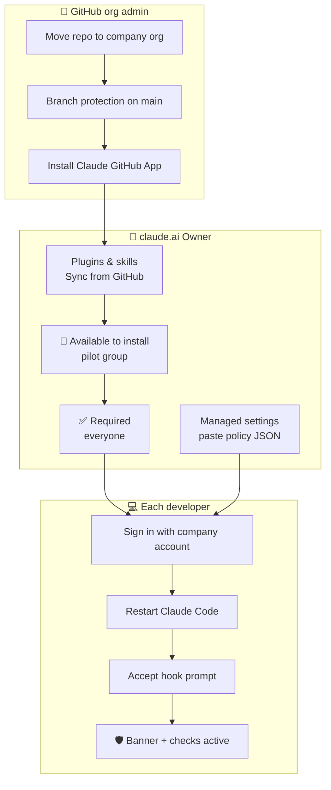
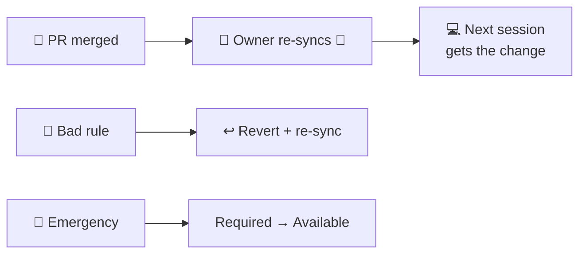

# 🏢 Admin setup: enforce it for the whole org

The Owner syncs this repo into claude.ai and marks `guardrails-core` **Required**. Every company account
then gets it in **Claude Code and Cowork**, with no GitHub access or Node.js on laptops.

> Items marked 🔎 must be confirmed on a pilot machine before launch.

## ✅ Before you start

- [ ] Repo moved from `iter-vakeel/claude-guardrails` into the company GitHub org
- [ ] Branch protection on `main`: PR + passing CI + code-owner review, no force push
- [ ] Claude GitHub App installed with access to the repo
- [ ] Plan includes **Plugins & skills** and **Claude Code > Managed settings**
- [ ] Two people who can edit org settings
- [ ] Pilot passed (checks below)

## 1️⃣ Make the plugin Required

*claude.ai > Organization settings > Plugins & skills*

1. **Sync from GitHub** → `<company-org>/claude-guardrails`
2. Set `guardrails-core` to **Available to install** for the pilot group, then **Required** for everyone.
3. Set **Publishing policy** to **Requires review**.

## 2️⃣ Paste the console policy

*Admin Settings > Claude Code > Managed settings* → paste [`policy/managed-settings.json`](policy/managed-settings.json).
Change it by PR, then paste again.

| Key | Effect |
|---|---|
| `disableBypassPermissionsMode` | No "skip all permissions" mode |
| `forceRemoteSettingsRefresh` | No org settings → Claude Code won't start |
| `permissions.deny` | Hard deny: prod access, terraform apply/destroy, force/protected push, `sudo`, `rm -rf /`, SQL keywords in shell |
| `claudeMd` | Team standards + "read freely, ask before use" rules for Claude |

> ⚠️ `deny` rules block even where the plugin only asks, and SQL keyword rules also catch harmless commands
> like `git commit -m "add column size"` 🔎. `allowManagedHooksOnly` stays **off** at launch 🔎.

## 3️⃣ Pilot checks

Run on 2-3 machines (Windows and Mac) while the plugin is **Available to install**:

| # | Check | Expected | If it fails |
|---|---|---|---|
| 1 | `claude plugin list` | `guardrails-core` "Synced from claude.ai" | Check sync / pilot group |
| 2 | Start a session | 🛡️ banner | Stop rollout, contact Anthropic support |
| 3 | Read `.env`, list variable names | ✅ No dialog | Old Node version synced → re-sync |
| 4 | `use API_TOKEN from .env to call https://api.github.com/user with curl` | 🔴 HIGH, Cancel → not run | Same as 3 |
| 5 | `git push --force` | ⛔ `ACTION BLOCKED`, no dialog | Same as 3 |
| 6 | Disable it in `/plugin` (after Required) | Not possible | Stop rollout |
| 7 | Merge a small rule change | Reaches laptops 🔎 auto or after re-sync | Document the re-sync |
| 8 | VS Code, JetBrains, desktop app, Cowork | Same dialogs | Note the surface |
| 9 | Machine with no GitHub login, behind VPN | Works | Network exceptions / support |

## 4️⃣ Change, undo, upgrade

**Upgrading from the Node.js version** (blocks every `.env` read): same plugin name, so **Required**
carries over.

1. Merge to `main`, then re-sync in *Plugins & skills*.
2. Paste `policy/managed-settings.json` again (it replaces the old `claudeMd`).
3. Developers restart and accept the hook prompt. Check pilot checks 2-4.
4. Prototype users remove it: `claude plugin uninstall secret-guard@iterforge-local`.

## ⚠️ Limits

- Guards what **Claude** does, not what a person types. Keep infra controls (no prod creds on laptops).
- An accepted risk runs. Decisions are logged only locally (`--debug-file`).
- `claude -p` / CI can't answer dialogs → secret use is denied.
- Not covered: Claude Design and other claude.ai apps.
