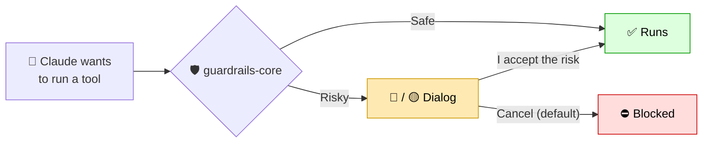

# 🛡️ claude-guardrails

**ITERFORGE security guardrails for Claude Code.** One mandatory plugin, `guardrails-core`, checks every
tool call Claude makes and asks the developer before anything risky happens.


## 🔄 How it works



- **Cancel is option 1**, so pressing Enter never accepts a risk. No one to answer (`claude -p`, CI) = blocked.
- Secret values are never shown in the dialog or the log (masked as `****`).
- Each session starts with a **Responsible AI Use** banner.

## 📏 What it checks

| Rule | 🔴 / 🟡 Asks before | ✅ No dialog |
|---|---|---|
| 1 · Secret files | Using `.env`, `*.pem`, `*.key`... (`source .env`, `cp .env`, `--env-file`) | Reading them |
| 2 · Secrets in commands / code | `curl -H "Bearer $TOKEN"`, a hardcoded password | `System.getenv("DB_PASSWORD")` |
| 3 · ORM auto-schema | `ddl-auto: update` / `create` | `validate`, `none` |
| 4 · Destructive migrations | `DROP`, `RENAME COLUMN`, `TRUNCATE`, type change | `ADD COLUMN`, new table |
| 5 · Direct DB changes | `psql` / `mysql` with `DELETE`, `ALTER`, `DROP`... | `select` |
| 6 · Risky git push | `--force`, push to `main` / `master` / `develop` | Push a feature branch |
| Personal data | Sending a seen email / SSN out | Reading logs that contain it |

🔴 **High** = a secret leaves the machine or is hardcoded, or rules 3-6. 🟡 **Medium** = a secret is used
locally, or personal data is sent out. Rules 3-6 can be made hard blocks with `HARD_BLOCK_POLICY = true`
in `hooks/register.ts`.

> 🧠 **Memory:** when Claude reads a file or command output that contains a secret value, the plugin
> remembers that value (in memory only, never on disk). If Claude later types the same value into a
> command or file, the plugin still catches it, even without a `.env` or `$TOKEN` name in sight.

## 🚀 Get started

| I want to... | Go to |
|---|---|
| 🧪 Try it on my machine | [DEVELOPER-SETUP.md](DEVELOPER-SETUP.md) |
| 🏢 Enforce it for the whole org | [ADMIN-SETUP.md](ADMIN-SETUP.md) |

```bash
claude plugin marketplace add mvakeel-vs/claude-guardrails
claude plugin install guardrails-core@claude-guardrails
```

Needs Claude Code **2.1.296+** and Git. **No Node.js.** Private repo: run `gh auth login` + `gh auth setup-git` first.

## 🛠️ Changing a rule

1. Branch → edit `hooks/register.ts` → add cases to `tests/guard.test.ts` → `npm test`
2. Pull request → CI (Linux, Windows, macOS) + code-owner review → merge. Laptops update next session.

- ⚠️ Don't add `version` to `plugin.json`, or machines stop getting updates.
- ⚠️ While the plugin is on, Claude can't edit `register.ts` / `guard.test.ts`. Edit them outside Claude.

## ⚠️ Limits

A **safety net for Claude's mistakes, not a security boundary**: it doesn't stop a person typing commands,
and an accepted risk runs. Decisions are logged only locally (`--debug-file`). Rule 3 also fires on docs
that mention the setting. Report false alarms to the code owners (`.github/CODEOWNERS`).
