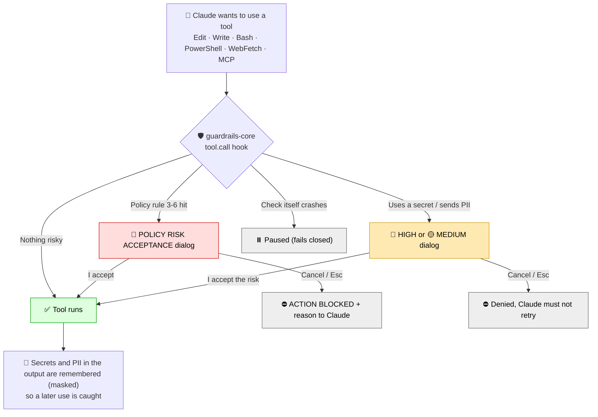
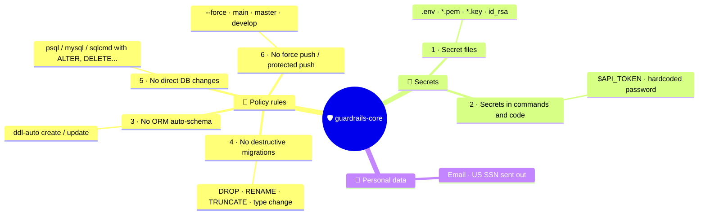
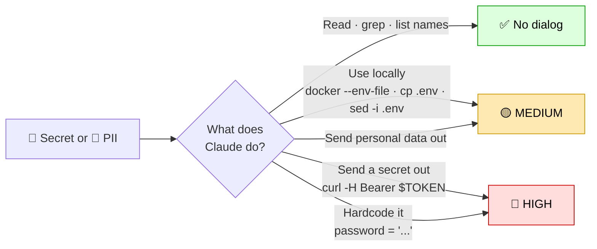
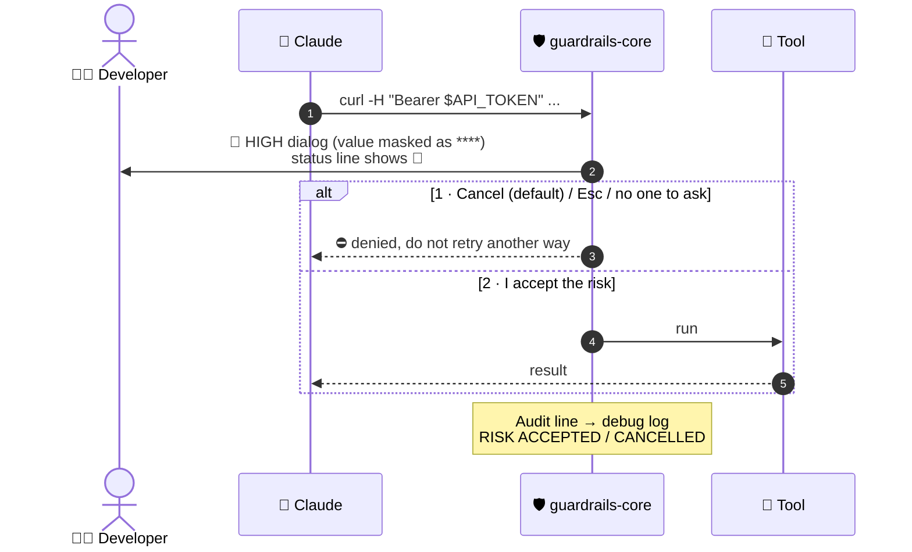
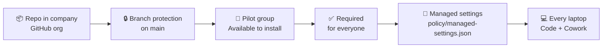
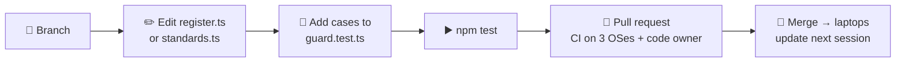

# 🛡️ claude-guardrails

**ITERFORGE security guardrails for Claude Code.** One mandatory plugin, `guardrails-core`, checks every
tool call Claude makes and asks the developer before anything risky happens.


| 📖 Read freely | 🟡 Ask before local use | 🔴 Ask before it leaves / breaks things |
|:---:|:---:|:---:|
| Secrets, logs, personal data | `.env` used locally, secret file changed | Secret sent out or hardcoded, policy rules 3-6 |

---

## 🔄 How it works



At session start the plugin shows a **Responsible AI Use** banner. The team engineering standards reach
Claude through the org policy (`claudeMd`).

---

## 📏 The rules



### Policy rules (🔴 dialog for now)

| # | Asks for | Passes |
|---|---|---|
| 3 | `ddl-auto` / `hbm2ddl.auto` = `create`, `create-drop`, `update` | `validate`, `none` |
| 4 | `DROP`, `RENAME COLUMN`, `TRUNCATE`, type changes, Liquibase `drop*` / `modifyDataType` | `ADD COLUMN`, new tables, indexes |
| 5 | DB CLIs with `ALTER/DROP/DELETE/UPDATE/INSERT/TRUNCATE/GRANT/REVOKE` or a SQL script | `select` |
| 6 | `--force`, `-f`, `+ref`, `--mirror`, `--all`, any push to `main`/`master`/`develop` | `git push origin feature/GPC-123` |

> 🔧 To make them **hard blocks** again: set `HARD_BLOCK_POLICY = true` at the top of
> `plugins/guardrails-core/hooks/register.ts` and update the test that checks the switch.

### Secrets: read freely, ask before use



### What the developer sees



**Cancel is option 1**, so a quick Enter never accepts a risk. Values are never shown in the dialog, the
status line or the audit log.

---

## 🚀 Get started

| I want to... | Go to |
|---|---|
| 🧪 Try it on my machine | [DEVELOPER-SETUP.md](DEVELOPER-SETUP.md) |
| 🏢 Enforce it for the whole org | [ADMIN-SETUP.md](ADMIN-SETUP.md) |

Quick install:

```bash
claude plugin marketplace add mvakeel-vs/claude-guardrails
claude plugin install guardrails-core@claude-guardrails
```

Needs Claude Code **2.1.296+** (tested on 2.1.312) and Git. **No Node.js** on developer machines. The repo
is private: the machine needs a git login (`gh auth login` + `gh auth setup-git`).

### Org rollout at a glance



---

## 🛠️ Changing a rule



```bash
npm test     # claude plugin validate + claude plugin test → "<n> pass", "0 fail"
```

- ⚠️ **No `version` in `plugin.json`**: a fixed version stops machines from getting updates.
- ⚠️ While the plugin is active, Claude Code blocks edits to `register.ts` and `guard.test.ts` (they contain
  rule 3 patterns). Edit them outside Claude, or `claude plugin disable guardrails-core@<marketplace>` +
  `/reload-plugins` for that session.
- Work on a local clone for one session: `claude --plugin-dir plugins/guardrails-core --debug-file guard.log`

### Repository layout

```
.claude-plugin/marketplace.json        marketplace catalogue
plugins/guardrails-core/
  hooks/register.ts                    all rules, dialogs, learning, banner wiring
  hooks/standards.ts                   banner text
  tests/guard.test.ts                  allow / block / ask + end-to-end dialog tests
policy/managed-settings.json           org console policy (deny rules + claudeMd)
scripts/new-guard-test.ps1             fake test project for DEVELOPER-SETUP
.github/workflows/guard-tests.yml      CI on Linux, Windows, macOS
```

---

## ⚠️ Known limitations

This is a **safety net for Claude's mistakes, not a security boundary**. It does not stop a person typing
commands, and it does not replace infrastructure controls. An accepted risk runs.

| Area | Behaviour |
|---|---|
| 📝 Audit | Only in the local debug log (`--debug-file`); no central record yet |
| 🧠 Memory | Seen secret values are forgotten when the plugin reloads; name-based rules still apply |
| 🤖 `claude -p` / CI | No one can answer the dialog → secret use is denied |
| 6️⃣ Rule 6 | `git commit -m push` on `main` triggers; `cd ~` / `cd $VAR` before a plain push fails closed |
| 3️⃣ Rule 3 | Also fires on docs and `grep` that mention the setting; misses `SPRING_JPA_HIBERNATE_DDL_AUTO` |
| 5️⃣ Rule 5 | A quoted `<` in SQL may look like a script redirect |

Report every false alarm (command or file, message, why it was legitimate) to the code owners in
`.github/CODEOWNERS`.
